<div align="center">

# Penetration Testing Report - Week 2

### Footprinting and Network Scanning Phases

**W2-PM-FINAL | Cybersecurity | Networkwalks**


</div>

---

## Table of contents

- [Report summary](#report-summary)
- [Liability disclaimer](#liability-disclaimer)
- [Tools used](#tools-used)
- [PM1 Footprinting with Kali tools](#pm1-footprinting-with-kali-tools)
- [PM4 theHarvester](#pm4-theharvester)
- [PM5 Network scanning with Zenmap](#pm5-network-scanning-with-zenmap)
- [Key observations](#key-observations)
- [Recommendations](#recommendations)
- [Repository structure](#repository-structure)
- [Author](#author)

---

## Report summary

| Field | Detail |
|---|---|
| **Pentester name** | Simranjit Kaur |
| **Program / Batch** | B084D - Networkwalks |
| **Report date** | 14 November 2026 |
| **Modules completed** | W2-PM1 (Multiple Kali Tools), W2-PM4 (theHarvester), W2-PM5 (Zenmap Scanning) |
| **Targets** | 1. networkwalks.com (under a Letter of Authorization)<br>2. My own home LAN (192.168.31.0/24)<br>3. microsoft.com - passive OSINT only, no packets sent to Microsoft by me |
| **Phases covered** | Phase 1: Reconnaissance and Footprinting<br>Phase 2: Scanning and Network Discovery |

**Full report:** [W2-PM-FINAL_Pentest_Report_Simranjit_Kaur_B084D.docx](W2-PM-FINAL_Pentest_Report_Simranjit_Kaur_B084D.docx) (includes the Letter of Authorization as Appendix A)

---

## Liability disclaimer

> I performed these activities only on systems and networks where I had written permission or that I own myself. This material is for education and research purposes only. Do not use anything from here to break the law. Every action you take is your own responsibility.

---

## Tools used

| Tool | Purpose |
|---|---|
| `whois` | Domain registration details |
| `whatweb` | Web technology fingerprinting |
| `nslookup` | Resolve the domain to an IP address |
| `curl -I` | Read HTTP response headers |
| `wafw00f` | Detect a Web Application Firewall |
| `dnsrecon` | Enumerate DNS records |
| `theHarvester` 4.11.1 | Passive OSINT (emails, sub-domains, hosts) |
| Zenmap (Nmap 7.993) | Ping scan and topology of my own LAN |
| Windows CMD (`ipconfig`) | Local IP, subnet and MAC address |

---

## PM1 Footprinting with Kali tools

**Target:** networkwalks.com | **Run on:** 13 November 2026, 21:50 to 21:56 IST

| # | Tool | Command | What I found |
|---|---|---|---|
| 1 | whois | `whois networkwalks.com` | Registrar GoDaddy.com, LLC; created 6 Nov 2019, expires 6 Nov 2027; name servers NS6135 and NS6136 at HostGator; DNSSEC unsigned |
| 2 | whatweb | `whatweb networkwalks.com` | Apache, WordPress 7.1.4, WP Download Manager 3.3.76, jQuery 3.7.1, IP 192.232.216.135, contact email exposed |
| 3 | nslookup | `nslookup networkwalks.com` | Resolves to 192.232.216.135 (via 8.8.8.8) |
| 4 | curl | `curl -I https://networkwalks.com` | HTTP 200, Apache, WordPress REST API (`/wp-json/`) in the Link header, no HSTS header seen |
| 5 | wafw00f | `wafw00f networkwalks.com` | Behind a ModSecurity (SpiderLabs) WAF |
| 6 | dnsrecon | `dnsrecon -d networkwalks.com` | 8 records: SOA and NS on HostGator, BIND 9.16.23-RH shown, MX and A on 192.232.216.135, SPF ending `~all`, cPanel autodiscover SRV records |

### PM1 screenshots

**1. whois**

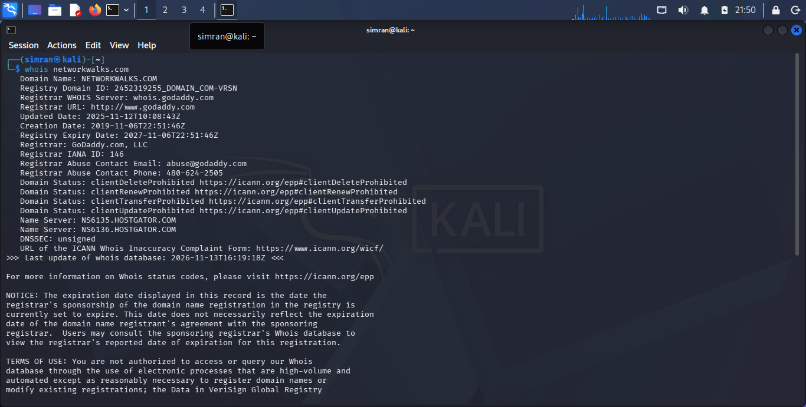

**2. whatweb**

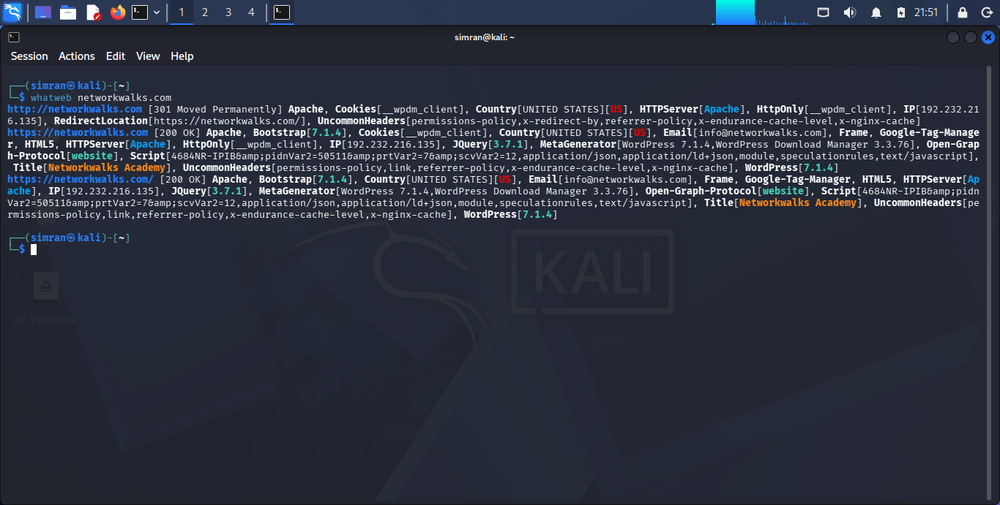

**3. nslookup**

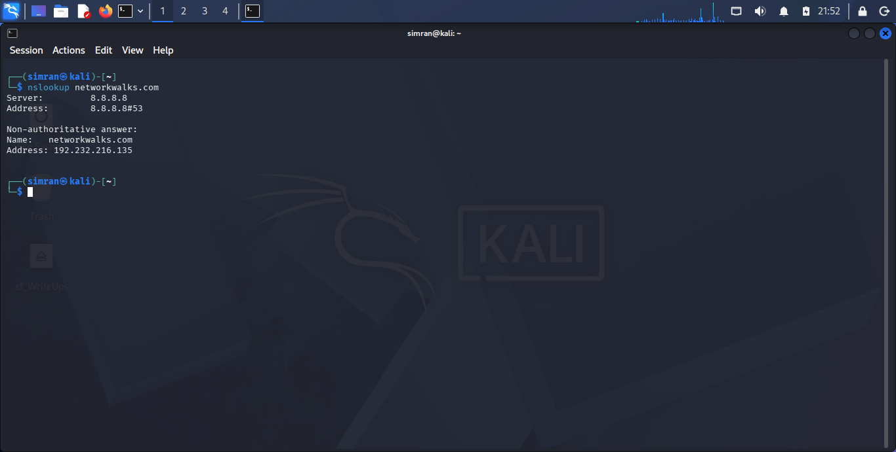

**4. curl -I**

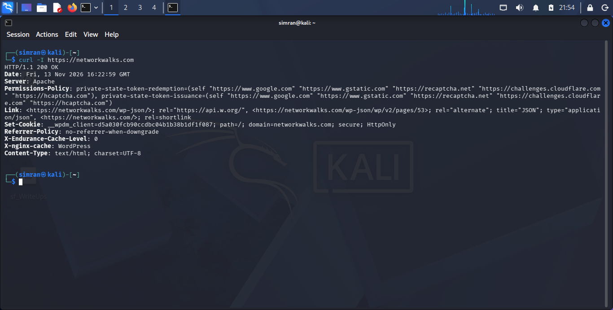

**5. wafw00f**

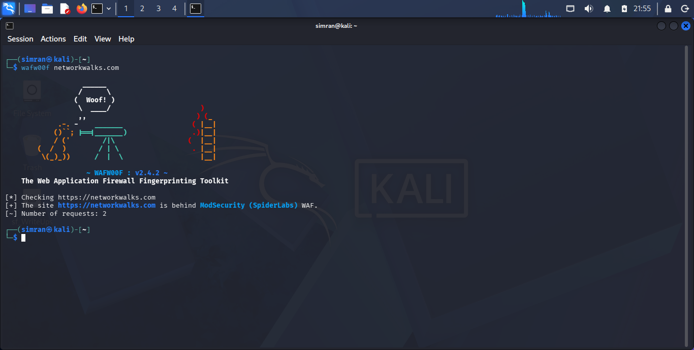

**6. dnsrecon**

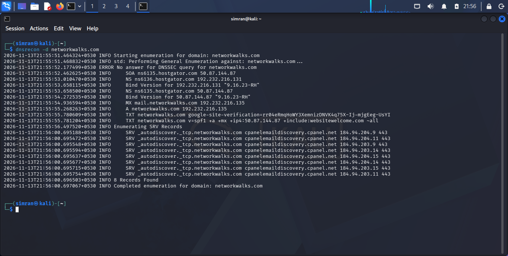


---

## PM4 theHarvester

**Run on:** 13 November 2026, about 22:00 to 22:08 IST. theHarvester only queries public sources, so I sent no scan traffic to Microsoft.

| Task | Command | Result |
|---|---|---|
| 1 | `theHarvester -d microsoft.com -l 1000 -b baidu` | No IPs, emails, people or hosts returned by Baidu |
| 2 | `theHarvester -d microsoft.com -l 50 -b all` | Some sources need API keys and failed; other sources returned a long list of microsoft.com hostnames and IPs. No email results were captured in my screenshots. |

### PM4 screenshots

**theHarvester help (version 4.11.1)**

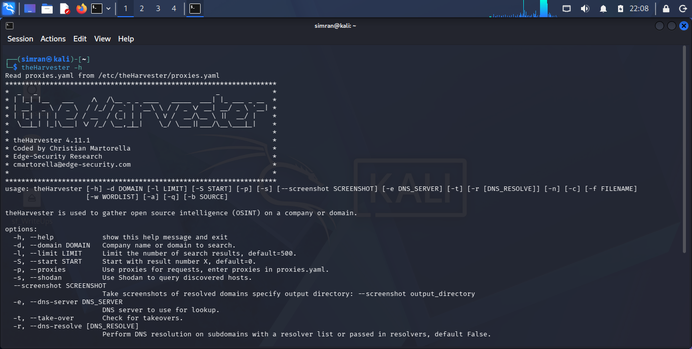

**Task 1 - Baidu source**

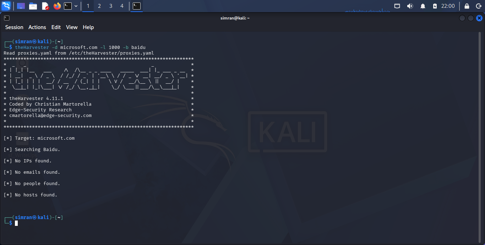

**Task 2 - all sources (start and API key errors)**

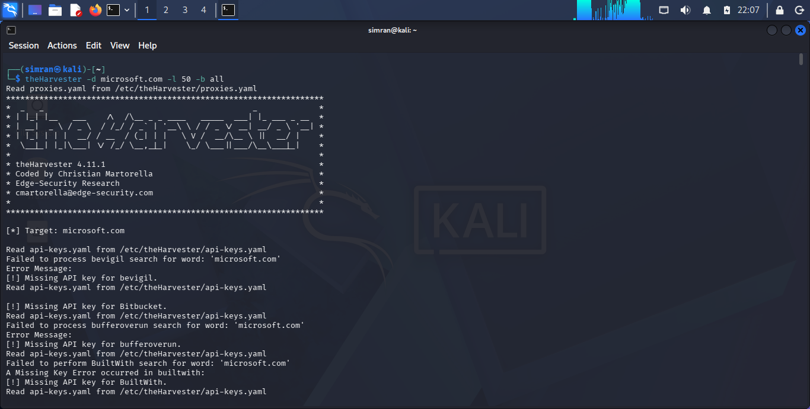

**Task 2 - all sources (hosts found)**

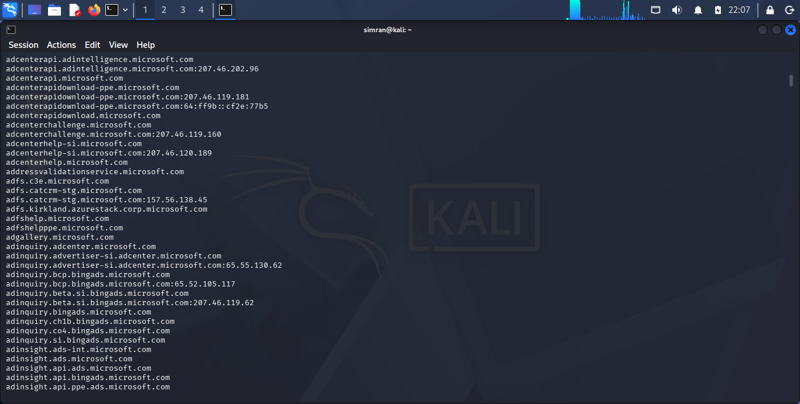


---

## PM5 Network scanning with Zenmap

**Scope:** my own home LAN only.

- Wi-Fi adapter: `192.168.31.125/24`, gateway `192.168.31.1`, so the subnet is `192.168.31.0/24`
- Scan: `nmap -sn 192.168.31.0/24` (Ping scan) on 14 Nov 2026 at 09:45 IST, **5 hosts up** in 3.74 seconds

| IP address | Device | MAC address |
|---|---|---|
| 192.168.31.1 | Router | 9C:D4:A6:xx:xx:xx |
| 192.168.31.43 | Android phone | 42:3D:B4:xx:xx:xx |
| 192.168.31.46 | Android phone | F2:E1:01:xx:xx:xx |
| 192.168.31.195 | Android phone | EC:30:B3:xx:xx:xx |
| 192.168.31.125 | My PC | 38-8D-3D-B7-6D-CE |

> Other devices' names and the last three bytes of their MAC addresses are hidden to protect their owners' privacy.

<div align="center">

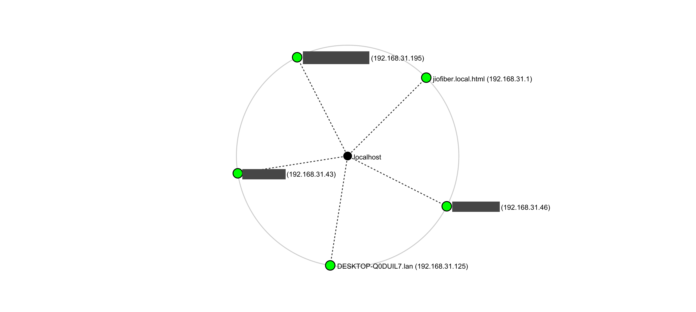

*Network topology saved from Zenmap*

</div>

- Topology PDF: [07_topology_saved_redacted.pdf](screenshots/PM5/07_topology_saved_redacted.pdf)
- Zenmap practice lab quiz score: **100%** ([screenshot](screenshots/PM5/08_lab_page_score_100.png))
- Extra: an earlier scan of the `10.0.0.0/24` adapter found only my own PC (1 host up), so I repeated the practical on the Wi-Fi LAN.

### PM5 screenshots

**Nmap installation finished**

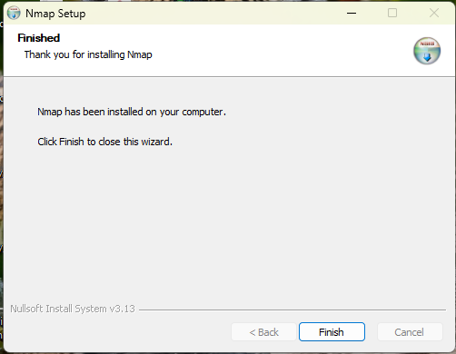

**Zenmap opened**

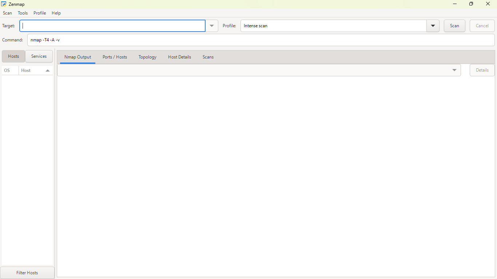

**ipconfig - Wi-Fi adapter and subnet**

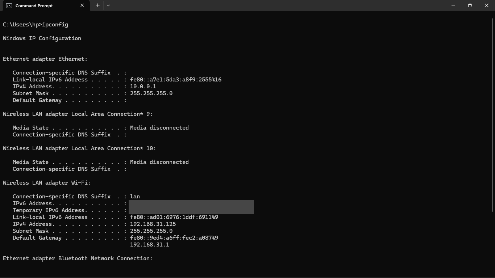

**ipconfig /all - own MAC address**

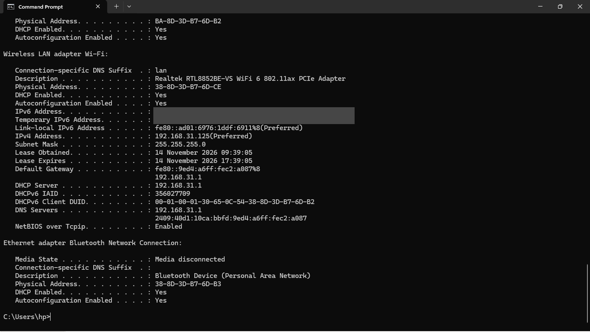

**Ping scan of 192.168.31.0/24**

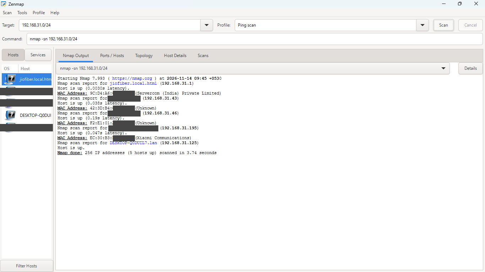

**Topology with legend**

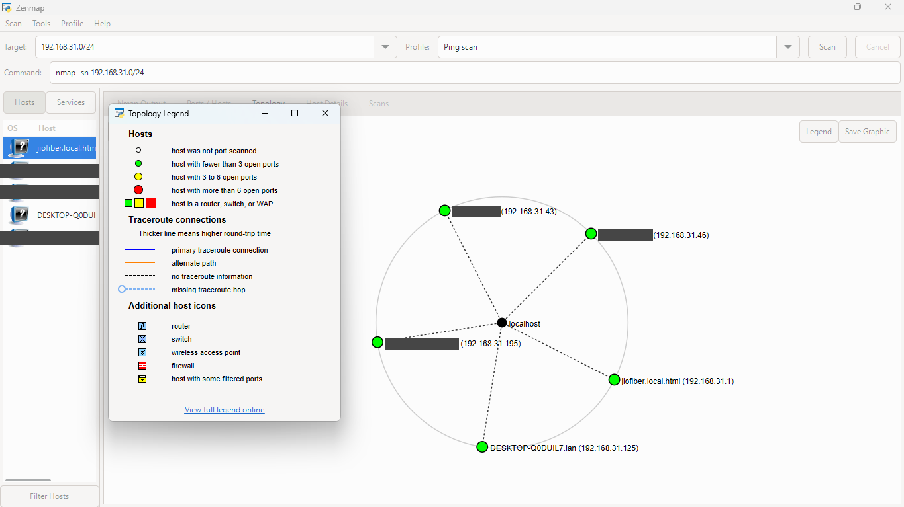

**Zenmap practice lab result**

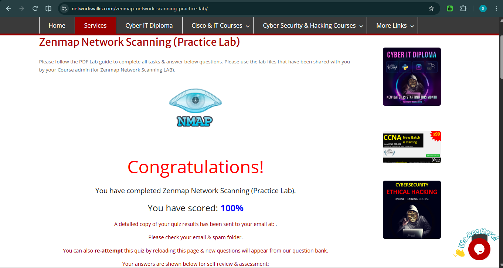

**Extra - lab adapter 10.0.0.0/24 (1 host up)**

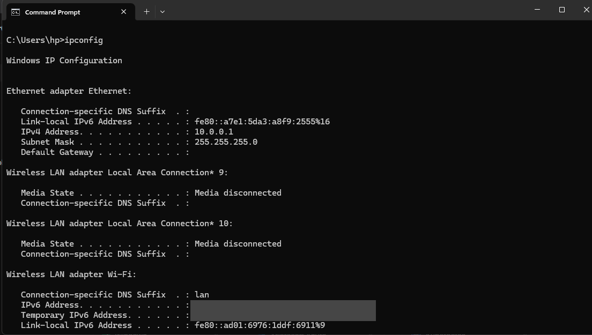

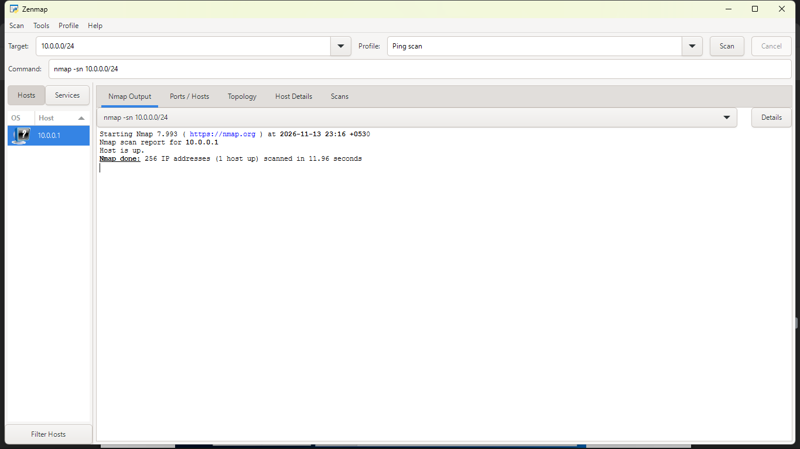


---

## Key observations

These are observations from information gathering, **not confirmed vulnerabilities**.

| # | Observation | Level |
|---|---|---|
| 1 | WordPress and plugin versions are publicly visible | Medium |
| 2 | DNS shows the BIND version, DNSSEC is unsigned and SPF uses soft fail (`~all`) | Medium |
| 3 | theHarvester can list many sub-domains from public sources | Medium |
| 4 | HTTP headers expose the REST API endpoint; no HSTS header was seen | Low |
| 5 | WAF technology (ModSecurity) is identifiable | Low |
| 6 | Several devices are visible on my home LAN | Low |
| 7 | NetBIOS over TCP/IP is enabled on my own PC | Low |

No exploitation or vulnerability validation was done in these modules.

---

## Recommendations

- Reduce exposed version information and keep software updated
- Add the HSTS header and review HTTP headers
- Hide the BIND version, consider DNSSEC and a stricter SPF policy
- Keep the WAF enabled and tuned
- Review public sub-domains and remove unused ones
- Disable unused legacy services such as NetBIOS over TCP/IP
- Scan my own network regularly and check for unknown devices
- Test only with authorisation

---

## Repository structure

```text
.
|-- README.md
|-- W2-PM-FINAL_Pentest_Report_Simranjit_Kaur_B084D.docx
`-- screenshots/
    |-- PM1/    6 screenshots
    |-- PM4/    4 screenshots
    `-- PM5/    10 files, including the topology PDF
```

---

## Author

**Simranjit Kaur**
Cybersecurity Intern, Batch B084D

LinkedIn: [simranjit-kaur-73a696288](https://www.linkedin.com/in/simranjit-kaur-73a696288)

Program: Cybersecurity program at Networkwalks | Week 02